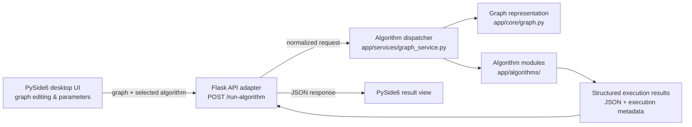

# GraphAlgo Pro — Interactive Graph Algorithms Laboratory

**Python · PySide6 · Flask · Graph Theory · Software Architecture · pytest**

A desktop graph-algorithm laboratory built as an **academic team software-engineering project**. Instead of running algorithms only in scripts, GraphAlgo Pro connects a visual graph editor to a local HTTP service and a modular Python algorithm engine.

**The engineering challenge:** make weighted, directed or undirected graphs editable, select an algorithm, pass graph data across a clean interface, and turn algorithm outputs into understandable results.

> **Status:** public source code and algorithm tests are available. This is a **local desktop application**, not a hosted web app. A verified installer, end-to-end UI demonstration and passing CI report are not currently provided.

## How the application is designed



**Implementation references:** [graph editor](front/GraphScene.py) · [desktop controller](front/MainWindow.py) · [HTTP adapter](server.py) · [graph model](app/core/graph.py) · [dispatch service](app/services/graph_service.py).

This architecture deliberately separates **presentation, transport, graph structure and algorithms**. The diagram represents source-code components, not an independently verified deployment.

## Implemented algorithm families

| Category | Algorithms in source | Engineering concepts |
| --- | --- | --- |
| Shortest paths | [Dijkstra](app/algorithms/shortest_path/dijkstra.py), [Bellman–Ford](app/algorithms/shortest_path/bellman_ford.py), [Bellman for DAGs](app/algorithms/shortest_path/bellman.py) | Non-negative weights vs. negative edges; graph constraints and path reconstruction |
| Minimum spanning trees | [Kruskal](app/algorithms/spanning_tree/kruskal.py), [Prim](app/algorithms/spanning_tree/prim.py) | Greedy methods, weighted edges, connectedness |
| Traversal | [BFS](app/algorithms/traversal/bfs.py), [DFS](app/algorithms/traversal/dfs.py) | Reachability, exploration order |
| Connectivity | [Connected components](app/algorithms/connectivity/connected_components.py), [strongly connected components](app/algorithms/connectivity/strongly_connected.py) | Undirected and directed structure |
| Eulerian paths | [Eulerian path/circuit](app/algorithms/eulerian/eulerian_path.py) | Connectivity and degree conditions |
| Vertex coloring | [Welsh–Powell](app/algorithms/coloring/welsh_powell.py) | Heuristic graph coloring, no optimality guarantee |
| Network flow | [Ford–Fulkerson](app/algorithms/flow/ford_fulkerson.py) | Capacities, source/sink, augmenting paths |

Not every algorithm accepts every type of graph. **Dijkstra requires non-negative edge weights; Bellman's DAG variant requires an acyclic directed graph; maximum-flow problems require valid non-negative capacities.** Algorithm implementations, UI integrations and individual test coverage should be considered separately.

## What a user can explore

1. Add vertices and edges/arcs in the desktop graph editor.
2. Configure directedness, edge weights or capacities as appropriate.
3. Select an algorithm and provide source/target parameters where needed.
4. Send the graph to the local Flask endpoint as JSON.
5. Inspect structured results in the desktop result view, such as paths, distances, tree edges, components, node colors or flow data.

The application uses a local HTTP request to `http://127.0.0.1:5000/run-algorithm`. The Flask adapter maps UI labels onto the algorithm dispatcher and returns structured JSON.

## Repository structure

```text
app/
  core/graph.py           Graph representation
  algorithms/             Shortest paths, spanning trees, flow, etc.
  services/graph_service.py
  utils/                  Input and graph helpers
front/                    PySide6 editor, scene and result windows
data/                     Example graph JSON and test fixtures
tests/
  algorithms/             Algorithm-specific pytest cases
  core/                   Graph and result-window tests
server.py                 Local Flask HTTP entry point
main.py                   JSON-based algorithm entry point
requirements.txt          Dependency list (currently needs syntax cleanup)
```

## Run locally — source version

**Prerequisites:** Python 3, an OS with desktop display support, and a local Qt/PySide6-compatible environment. These commands are a **manual setup path**, not a claim that the app was freshly run successfully on all operating systems.

```bash
git clone https://github.com/Edam-laa/graph_lab.git
cd graph_lab
python -m venv .venv
```

Activate the environment:

```powershell
# Windows PowerShell
.venv\Scripts\Activate.ps1
```

Or, on Linux/macOS, use `source .venv/bin/activate`.

**Dependency note:** the current [`requirements.txt`](requirements.txt) contains human-readable descriptions using arrow symbols on the same lines as package names. It is **not valid pip requirements syntax**. Until that file is fixed, use:

```bash
python -m pip install Flask PySide6 requests pytest
```

Optional packages listed in the original file include `flask-cors` and `pyinstaller`, which are not required by the basic launch commands below.

In **terminal 1**, run the API:

```bash
python server.py
```

In **terminal 2**, using the same environment, run the desktop UI:

```bash
python -m front.Main
```

Flask is configured in debug mode for local development. **Do not expose the development server to the Internet.**

## Verification and test evidence

A structured test suite exists, including [Dijkstra tests](tests/algorithms/test_dijkstra.py), [Bellman–Ford tests](tests/algorithms/test_bellman_ford.py), [Kruskal tests](tests/algorithms/test_kruskal.py), [flow tests](tests/algorithms/test_ford_fulkerson.py), and [graph-model tests](tests/core/test_graph.py). The [algorithm test notes](tests/algorithms/README.md) document expected graph constraints.

After installing the dependencies above:

```bash
python -m pytest -q tests/
```

**Validation status:** the available GitHub Actions runs on a separate portfolio-review branch did **not** establish a passing suite (one failed on a missing Qt system dependency; a later run was cancelled). Do not infer passing tests or coverage from the presence of test files. A validated environment and CI result are outstanding.

### Screenshots and demo

The repository does **not** currently include an authentic editor screenshot or a recorded desktop demo. The Mermaid diagram explains the architecture; it is **not** a substitute for an actual running UI. An appropriate future demo would show a small weighted graph, the selected algorithm and its result window in a single reproducible example.

## Engineering lessons and trade-offs

- **Separation of concerns:** UI interactions do not directly implement graph algorithms; the service layer mediates requests and results.
- **Data contracts:** JSON graph data and result schemas allow the desktop interface and calculation engine to evolve separately, while creating input-validation obligations.
- **Algorithm correctness:** edge cases such as negative weights, disconnected graphs, invalid endpoints and capacities require explicit testing.
- **Local HTTP boundary:** useful for modularity, but introduces two-process startup, communication and error-handling requirements compared with a monolithic Qt app.
- **Current limitations:** no verified packaged binary in the repo, invalid requirements syntax, incomplete CI evidence, no genuine UI screenshots, and possible UI/API edge cases.

## Contributors

Developed as an **academic GrafixLab team project**. Credit belongs to the team; individual ownership of every subsystem is not claimed without a verified contribution breakdown.
