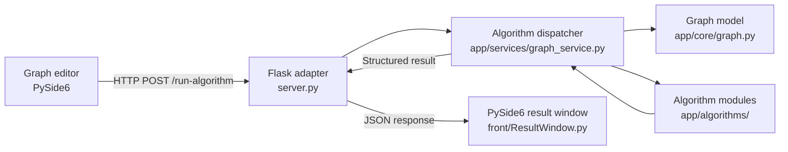

# GraphAlgo Pro
**Interactive Graph Algorithms Laboratory · Python · PySide6 · Flask**

GraphAlgo Pro is an academic graph-algorithm exploration application developed by the **GrafixLab team**. It combines an interactive desktop graph editor with a Python algorithm library and a local Flask HTTP service. Users can create graphs, choose an algorithm, and inspect returned paths, components, trees, colors, or flow-related results.

> **Project type:** academic group project / desktop application. This repository contains source code and tests, but does not include a verified public installer or a running online demo.

## What this project demonstrates

- A layered software architecture separating UI, HTTP adaptation, graph representation, and algorithm implementations.
- An interactive **PySide6** graph editor and results UI.
- Classical graph algorithms and parameterized test cases.
- A local **Flask** endpoint bridging the desktop UI to the algorithm service.
- Pytest test modules for algorithms and core components.

## Architecture



The diagram is a logical view of the implementation. The service and desktop interface run **locally**; this is not a deployed web application.

## Algorithms in the repository

| Family | Implementations | Key constraints / observations |
| --- | --- | --- |
| Shortest paths | Dijkstra, Bellman-Ford, Bellman (DAG) | Dijkstra requires non-negative weights; DAG methods require an acyclic directed graph |
| Minimum spanning trees | Kruskal, Prim | Weighted undirected graphs; disconnected graphs may require forest handling |
| Traversal | BFS, DFS | Explore reachable vertices |
| Connectivity | Connected and strongly connected components | Directedness changes the meaning of connectivity |
| Eulerian routes | Eulerian path / circuit | Degree and connectivity conditions apply |
| Coloring | Welsh–Powell | Heuristic; not guaranteed to be optimal |
| Maximum flow | Ford–Fulkerson | Non-negative capacities, specified source and sink |

See [algorithm implementations](app/algorithms/) and [algorithm tests](tests/algorithms/). Having an implementation file does not imply every UI/algorithm combination has been manually checked; run tests and verify your chosen graph before drawing conclusions.

## Repository organization

```text
app/
  algorithms/       # Graph algorithms grouped by category
  core/graph.py     # Graph data representation
  services/         # Execution / dispatch
  utils/            # JSON loading and helpers
front/              # PySide6 editor, graph scene, views and result window
data/               # JSON example and test graphs
tests/              # Pytest algorithm and core tests
server.py           # Flask API entry point
requirements.txt    # Python dependencies
```

## Run locally

**Prerequisites:** Python 3 and a machine able to display Qt/PySide6 windows. Installation and execution have not been verified on every operating system.

```bash
git clone https://github.com/Edam-laa/graph_lab.git
cd graph_lab
python -m venv .venv
# Activate the environment for your shell, then:
python -m pip install -r requirements.txt
```

Open **two terminals** using that environment. Start the backend first:

```bash
python server.py
```

In the second terminal:

```bash
python -m front.Main
```

The backend listens at `http://127.0.0.1:5000` and exposes `POST /run-algorithm`. The client uses it to request calculations. The local backend in `server.py` enables Flask debug mode; **do not expose it to the Internet**.

**Windows PowerShell activation:** `.venv\Scripts\Activate.ps1`

**Linux/macOS activation:** `source .venv/bin/activate`

### How to explore

Create nodes and edges in the graph editor, choose appropriate direction/weights/capacities, then select an algorithm. The UI can show the graph and structured results. For example, try Dijkstra with non-negative weighted edges or Welsh–Powell on an undirected graph.

## Testing

```bash
python -m pytest -q tests/
```

The repository includes tests for shortest paths, trees, connectivity, coloring, flow, Eulerian paths, and graph behavior. **Test results are not claimed here:** the full suite must be run in a compatible local environment before reporting passes or coverage.

## UI evidence

The repository currently has **no committed authentic screenshots** of the editor or result view. A useful follow-up is to capture a representative graph and an algorithm result from a real running instance; generated or mock screenshots must not be presented as execution evidence.

## Engineering decisions and limitations

- **Why Flask + PySide6?** The desktop graph editor is separated from the algorithm execution service using a simple JSON/HTTP interface.
- **Why separate algorithm modules?** Each family can evolve and be tested independently.
- **Why tests?** Incorrect graph-algorithm behavior may be hard to notice from a drawing alone; focused test cases help detect regressions.
- **Known limitations:** no hosted demo, no verified installer published in this repository, CI verification must be read from GitHub Actions runs, and potential UI/API integration edge cases. The source tree should be validated against target Python/Qt versions.

## Credits

Created as a **GrafixLab team** academic project. The repository does not establish a reliable individual contribution breakdown; credits should be updated only with verified team agreement.
